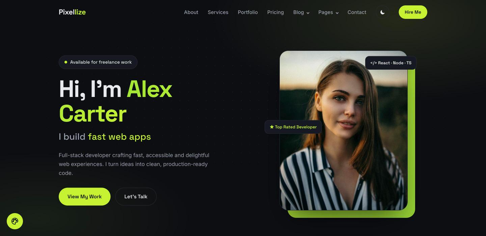
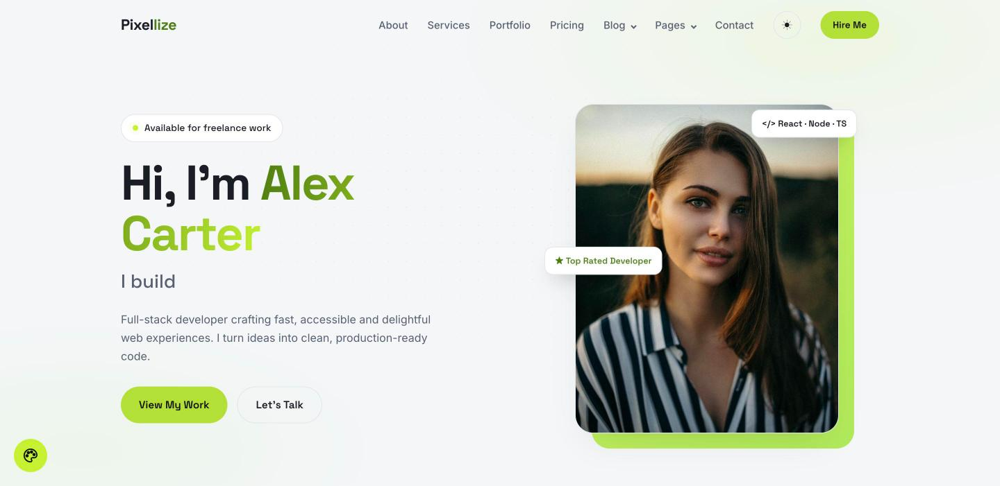

# Pixellize — Personal Portfolio HTML Template

A modern, fully responsive **one-page personal portfolio** template built with clean **HTML5, CSS3 and vanilla JavaScript** — no frameworks, no build tools, no dependencies.

Perfect for developers, designers, freelancers and creatives who want a fast, elegant site that stands out.

- **Preview Link** — [https://shubham-ralli.github.io/Pixellize-Personal-Portfolio-HTML-Template](https://shubham-ralli.github.io/Pixellize-Personal-Portfolio-HTML-Template)



<p align="center"><em>Dark mode</em></p>



<p align="center"><em>Light mode</em></p>

---

## ✨ Features

- 📱 Fully responsive, mobile-first design
- 🌗 **Dark & light mode** with saved preference
- 🎨 **3 accent color schemes** (lime / blue / purple) + live style switcher
- 🔁 Full **RTL** support
- 📰 **Blog** — listing (search, category filter, sidebar) + single post with nested comments & share buttons
- 🖼️ Portfolio **bento grid** with project detail modal
- ✨ Animated counters, typing effect, scroll reveal, client logo marquee
- 💲 Pricing with monthly/yearly toggle, FAQ accordion, testimonials slider
- ✉️ Working **PHP contact form** with spam protection
- 🚧 Bonus **404** and **Coming Soon** pages
- ♿ Accessible, SEO-friendly, **W3C-valid** code
- 📄 Detailed documentation included

## 📄 Pages

| Page | Description |
|------|-------------|
| `index.html` | Hero, About, Services, Process, Portfolio, Stats, Pricing, Testimonials, FAQ, Blog, Contact |
| `blog.html` | Blog listing with featured post, search, categories, sidebar |
| `blog-single.html` | Single article with share buttons + nested comments |
| `404.html` | 404 error page |
| `coming-soon.html` | Coming-soon page with live countdown |
| `documentation.html` | Full setup & customization guide |

## 🚀 Getting Started

No installation needed. Open `index.html` in a browser, or (recommended) run a tiny local server from the project root:

```bash
# Python 3
python3 -m http.server 8000

# or Node
npx serve .
```

Then visit `http://localhost:8000`.

## 🎨 Customization

All colors are **CSS variables** at the top of `assets/css/style.css`:

```css
:root {
  --accent:   #c4f135;  /* main brand color */
  --accent-2: #a3e635;  /* gradient partner  */
  --bg:       #0d0e12;  /* page background   */
  --text:     #e7e9ee;  /* body text         */
}
```

- **Colors** — change the variables above, or use the floating style switcher (3 built-in schemes).
- **Dark/Light** — toggle in the header; preference is saved.
- **Text & images** — edit the HTML directly and swap files in `assets/images/`.
- **RTL** — add `dir="rtl"` to the `<html>` tag.

## ✉️ Contact Form

The form posts to `contact.php` via AJAX. To enable it:

1. Upload to a **PHP-enabled host**.
2. Set your email in `contact.php`:

```php
$recipient = 'you@yourdomain.com';
```

Includes a honeypot spam filter and header-injection protection.

## 📁 Folder Structure

```
pixellize/
├── index.html
├── blog.html
├── blog-single.html
├── 404.html
├── coming-soon.html
├── documentation.html
├── contact.php
├── credits.txt
└── assets/
    ├── css/style.css
    ├── js/main.js
    ├── favicon.svg
    └── images/
```

## 🙌 Credits

- **Fonts** — [Space Grotesk](https://fonts.google.com/specimen/Space+Grotesk) & [Inter](https://fonts.google.com/specimen/Inter) (SIL OFL)
- **Icons** — custom inline SVG (nothing to attribute)
- **Images** — demo photos from [Unsplash](https://unsplash.com) (see `credits.txt`)

## 📜 License

Template code is released per your marketplace license. Replace the demo Unsplash images with your own for production use.

---

Built with care. If you find Pixellize useful, a ⭐ is appreciated!
